# ms-vehiculos · DevOps (DOY0101)

Microservicio REST de vehículos (Spring Boot 4, Java 25, MySQL 8) con un pipeline CI/CD en GitHub Actions que **prueba, analiza, valida políticas de seguridad, contenedoriza y despliega automáticamente con Docker Compose en AWS EC2**, con **monitoreo, alarmas y dashboard en AWS CloudWatch**.

**Integrantes:** _Nombre 1_ · _Nombre 2_

---

## 1. Arquitectura

```
 Desarrollador ──PR──▶ GitHub (main protegida: PR + checks obligatorios)
                          │
                          ▼
                   GitHub Actions
   1. Build y pruebas ─ JUnit 5 + Mockito + JaCoCo (cobertura)
   2. SonarCloud ────── Quality Gate (seguridad A, cobertura ≥ 80%)
   3. Seguridad ─────── Hadolint · docker compose config · Trivy config · Trivy imagen
                        └─ (solo main) imagen → GHCR, etiquetada con el SHA
   4. Despliegue ────── SSH → docker compose pull + up (espera "healthy")
                        └─ envía métricas del pipeline a CloudWatch
                          │
                          ▼
   AWS EC2 · Docker Compose                       AWS CloudWatch
   ┌──────────────────────────────────┐        ┌──────────────────────────────┐
   │ ms-vehiculos :80 → 9004 (health) │─logs──▶│ Logs /ms-vehiculos/app       │
   │ mysql 8 (volumen, solo local)    │─logs──▶│ Logs /ms-vehiculos/mysql     │
   │ CloudWatch Agent (mem, disco)    │─mét.──▶│ Métricas EC2 · App · Pipeline│
   └──────────────────────────────────┘        │ 4 alarmas ─▶ SNS ─▶ correo   │
                                               │ Dashboard ms-vehiculos-devops│
                                               └──────────────────────────────┘
```

## 2. Etapas del pipeline

| # | Etapa | Herramientas | Si falla… |
|---|---|---|---|
| 1 | Build y pruebas | Maven, JUnit 5, Mockito, JaCoCo | Se detiene: no se analiza ni se construye imagen |
| 2 | Calidad de código | SonarCloud (Quality Gate) | Se detiene: no se construye imagen |
| 3 | Seguridad y contenedor | Hadolint, `docker compose config`, Trivy (configuración e imagen) | Se detiene si hay errores o vulnerabilidades CRITICAL |
| 4 | Despliegue | SSH + Docker Compose en EC2 | Falla si el contenedor no queda *healthy* o `/actuator/health` no responde |

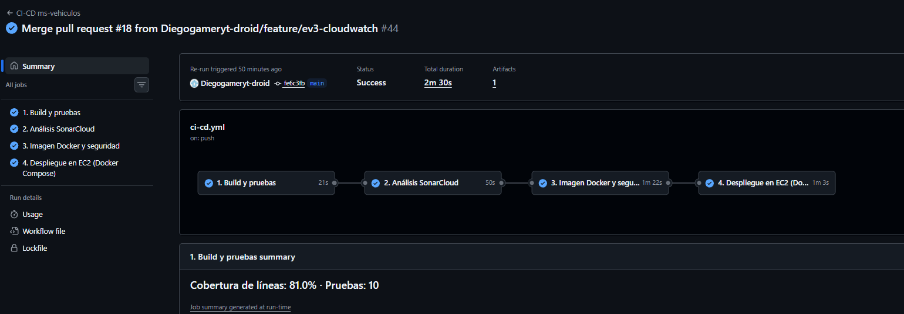

## 3. Políticas de cumplimiento (IE5)

| Política | Dónde se aplica | Evidencia |
|---|---|---|
| Quality Gate de SonarCloud (seguridad A, cobertura ≥ 80%, duplicación ≤ 3%) | Etapa 2 | [ver](docs/img/sonarcloud-passed.png) |
| Buenas prácticas de Dockerfile (Hadolint) y archivos Compose válidos | Etapa 3 | [ver](docs/img/pipeline-verde.png) |
| Configuración sin problemas CRITICAL (Trivy config) | Etapa 3 | [ver](docs/img/pipeline-verde.png) |
| Imagen sin vulnerabilidades CRITICAL con parche disponible (Trivy) | Etapa 3 | [ver](docs/img/pr-vulnerable-trivy.png) |
| Dependencias revisadas semanalmente (Dependabot) y análisis de Snyk en los PR | GitHub | [ver](docs/img/dependabot-prs.png) |
| Rama `main` protegida: PR obligatorio, 1 aprobación, checks 1–3 obligatorios, sin force push | GitHub Rulesets | [ver](docs/img/branch-protection-1.png) · [ver](docs/img/branch-protection-2.png) |
| Contenedor sin root, con healthcheck y límites de CPU/memoria | Dockerfile + Compose | `Dockerfile`, `docker-compose.yml` |
| Secretos fuera del código (GitHub Secrets → `.env` en la EC2; rol IAM para AWS) | Pipeline + EC2 | `deploy/deploy.sh` |

### Revisión de hallazgos de seguridad

El Quality Gate bloqueó el pipeline por la nota de seguridad. Se corrigió el hallazgo de severidad alta (acción de terceros sin SHA fijo, reemplazada por un comando `docker login`) y se aceptaron con justificación los de uso de `http://` (EC2 del Learner Lab sin dominio ni certificado TLS).

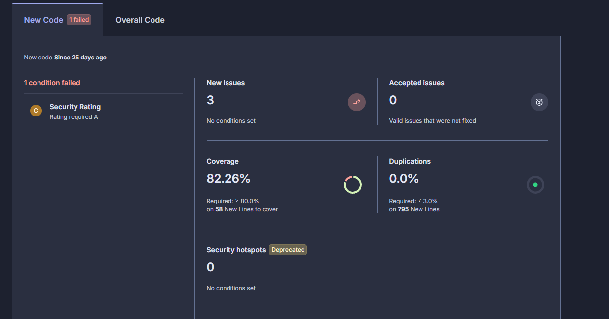
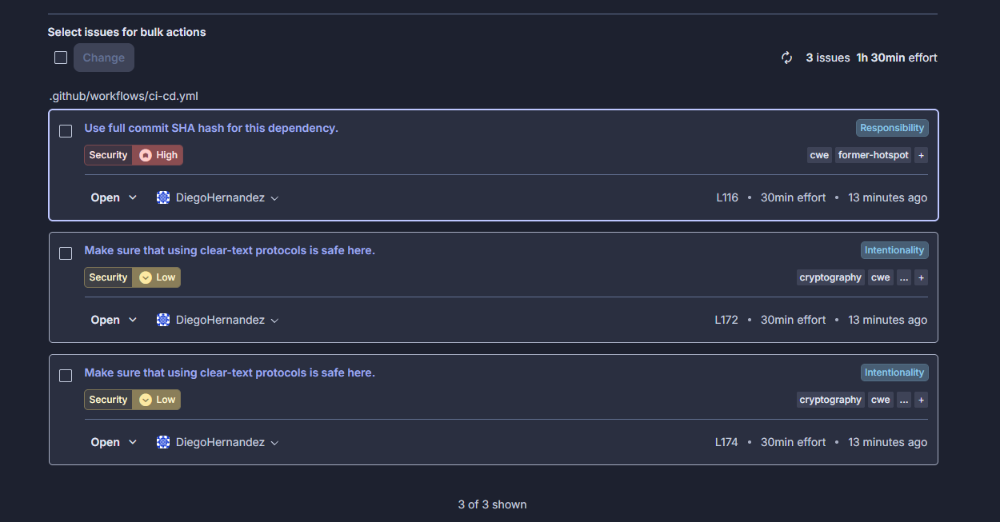
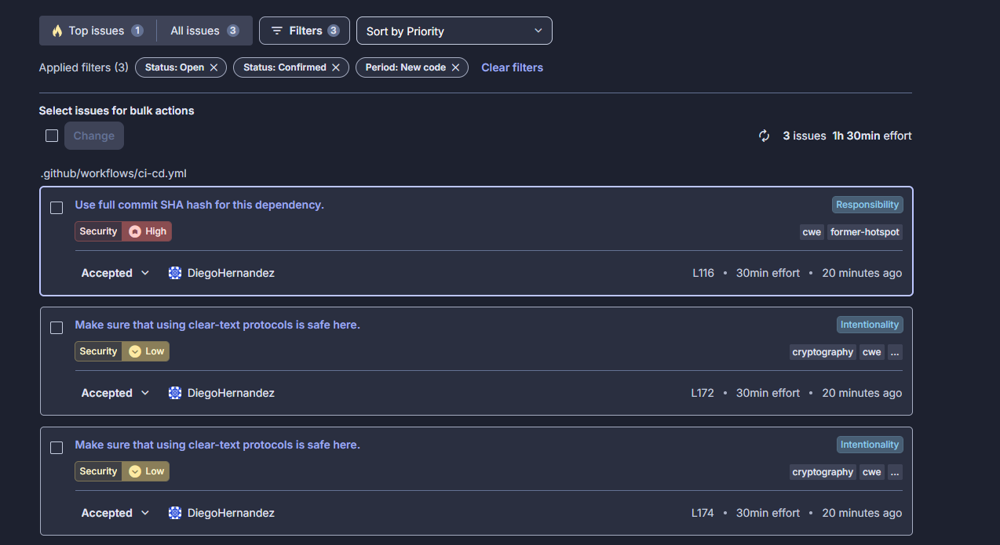
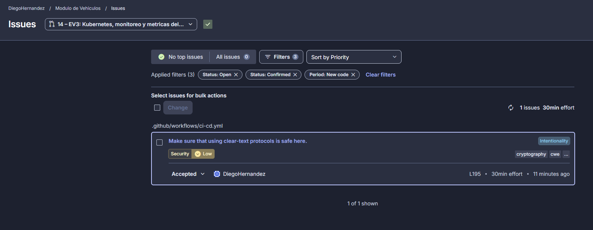
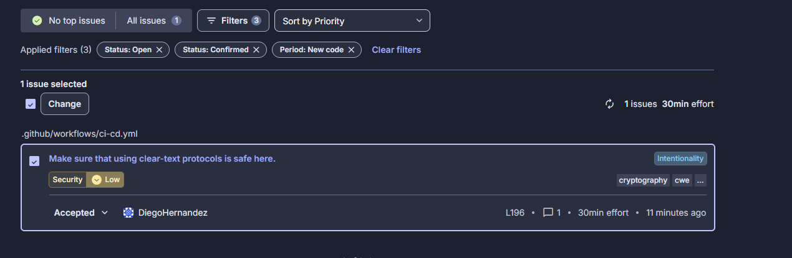
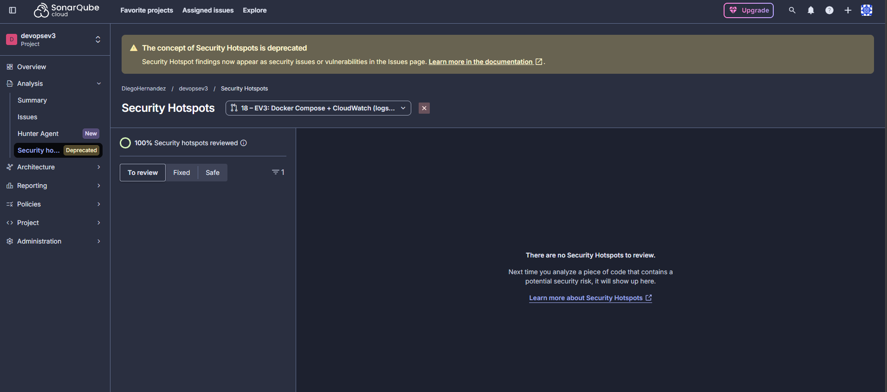
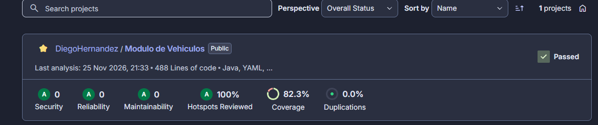

## 4. Detención ante errores críticos (IE6)

Prueba realizada: PR #11 agregó `commons-collections:3.2.1` (vulnerabilidad CRITICAL conocida).
- Trivy detuvo la etapa 3 → la imagen **no se publicó** y el despliegue **no se ejecutó**.
- Snyk también marcó el PR como fallido.
- La protección de `main` **bloqueó el merge**.

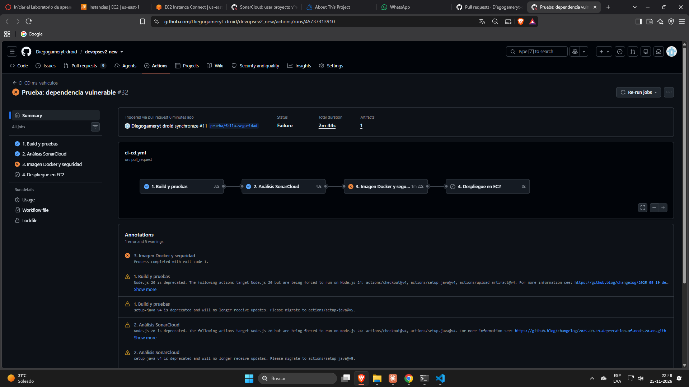
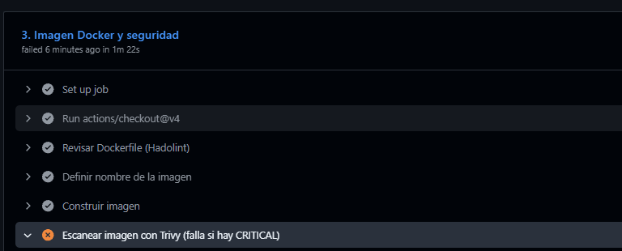
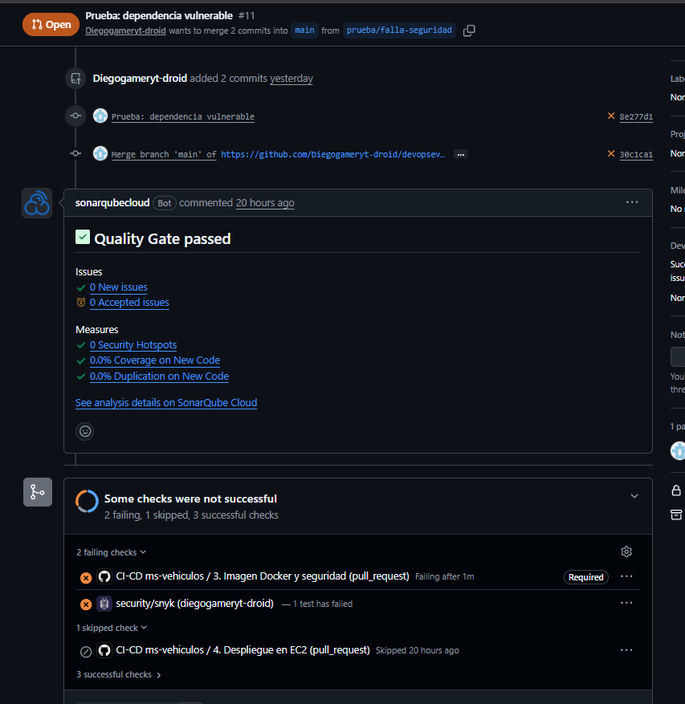

**Protección de la rama `main`:**

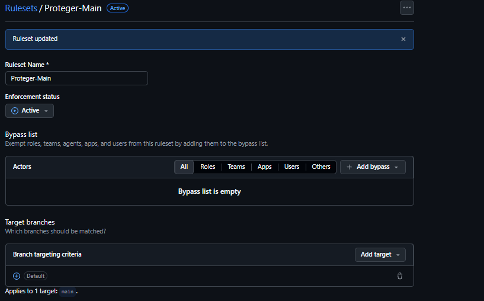
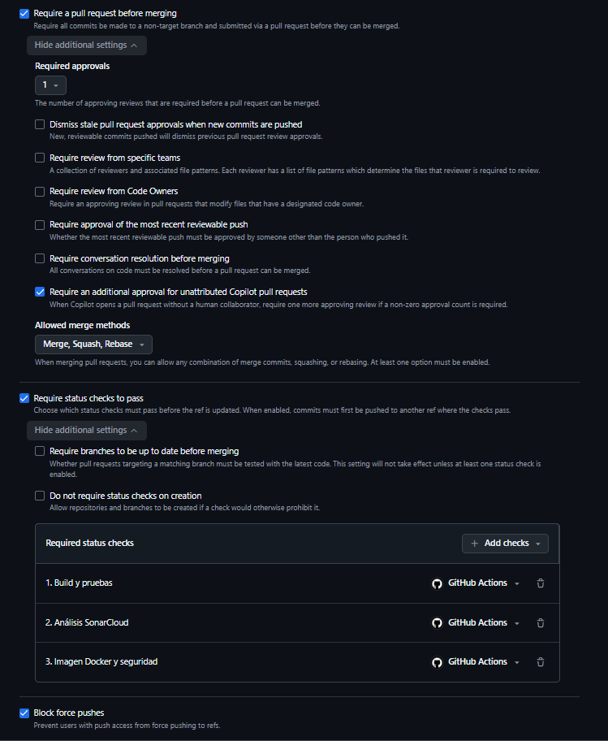

## 5. Despliegue orquestado en la nube (IE2)

- **Entorno:** AWS EC2 (AWS Academy Learner Lab) con **Docker Compose**.
- **Servicios:** `ms-vehiculos` (puerto 80 → 9004) y `mysql` (volumen persistente, solo accesible desde la EC2; MySQL Workbench entra por túnel SSH).
- **Orquestación:** `depends_on` con `service_healthy` (la app espera a MySQL), healthchecks, `restart: unless-stopped` y límites de CPU/memoria.
- **Integración con monitoreo:** `docker-compose.aws.yml` envía los logs de cada contenedor a CloudWatch Logs (driver `awslogs`), usando el rol IAM de la EC2 (sin claves en el código).
- **Trazabilidad:** cada despliegue usa la imagen `ghcr.io/.../devopsev2_new:<sha-del-commit>`.

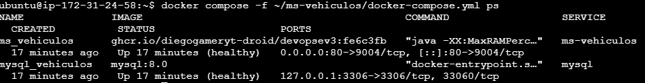
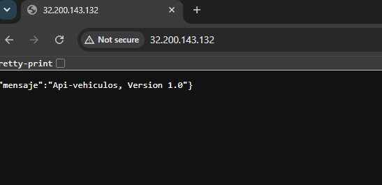
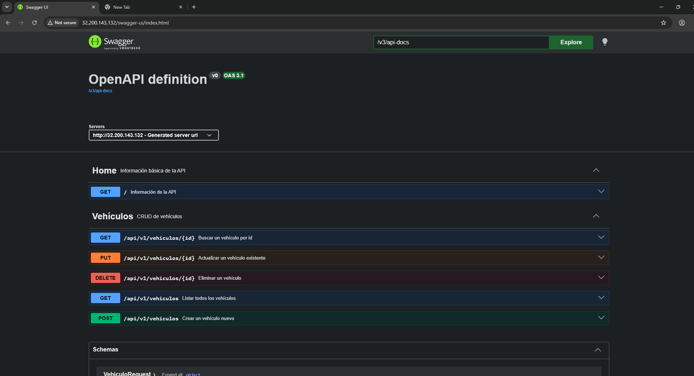

## 6. Monitoreo y alarmas (IE1)

| Necesidad | Herramienta | Qué muestra |
|---|---|---|
| Logs | Driver `awslogs` → CloudWatch Logs | Logs de la app y de MySQL (`/ms-vehiculos/app`, `/ms-vehiculos/mysql`) |
| Errores y tráfico | Filtros de métricas sobre el access log de Tomcat | Peticiones HTTP, errores 4xx, errores 5xx, líneas ERROR/Exception |
| Recursos | Métricas de EC2 + CloudWatch Agent | CPU, memoria, disco y swap |
| Disponibilidad | Healthcheck de Docker + verificación del pipeline | Estado `healthy` y respuesta de `/actuator/health` |
| Métricas del pipeline | `aws cloudwatch put-metric-data` desde el despliegue | Cobertura, cantidad de pruebas, tiempo de despliegue, lead time |

**Alarmas (aviso por correo con SNS):**

| Alarma | Condición |
|---|---|
| `ms-vehiculos-cpu-alta` | CPU de la EC2 > 80% durante 5 minutos |
| `ms-vehiculos-memoria-alta` | Memoria de la EC2 > 85% |
| `ms-vehiculos-errores-5xx` | Al menos 1 error 5xx en 1 minuto |
| `ms-vehiculos-errores-4xx` | Más de 20 errores 4xx en 1 minuto |

Configuración (una vez, en la EC2): `bash monitoring/cloudwatch-setup.sh correo@duocuc.cl`

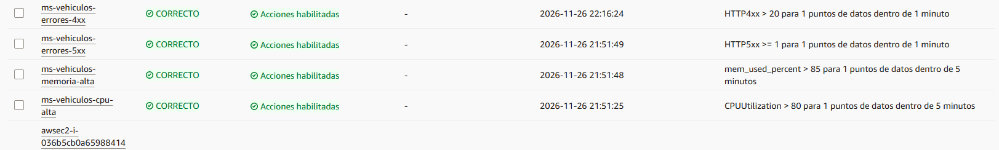
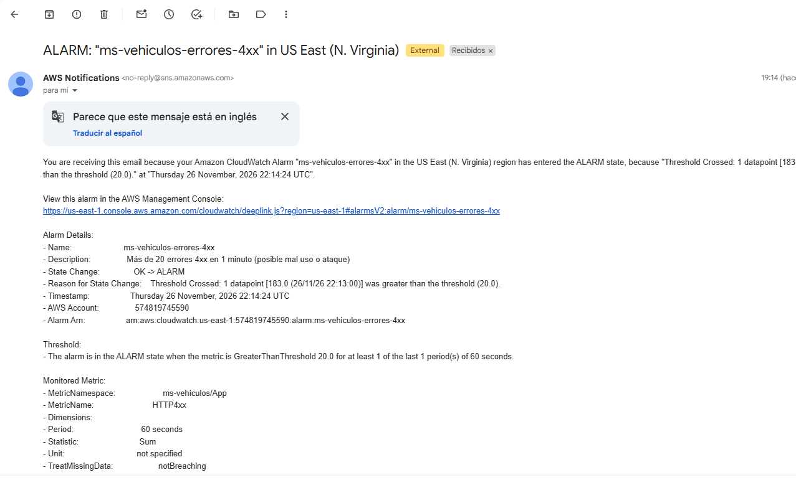


## 7. Dashboard (IE3)

Dashboard **`ms-vehiculos-devops`** en CloudWatch (`monitoring/cloudwatch-dashboard.json`):

- **Estado de las alarmas.**
- **Pipeline CI/CD:** **cobertura de pruebas**, pruebas ejecutadas, **tiempo de despliegue**, lead time.
- **Recursos:** **CPU, memoria** y disco de la EC2.
- **Tráfico y errores:** peticiones, **errores 4xx y 5xx**, errores en logs.
- **Logs:** logs con errores y últimos logs del microservicio.

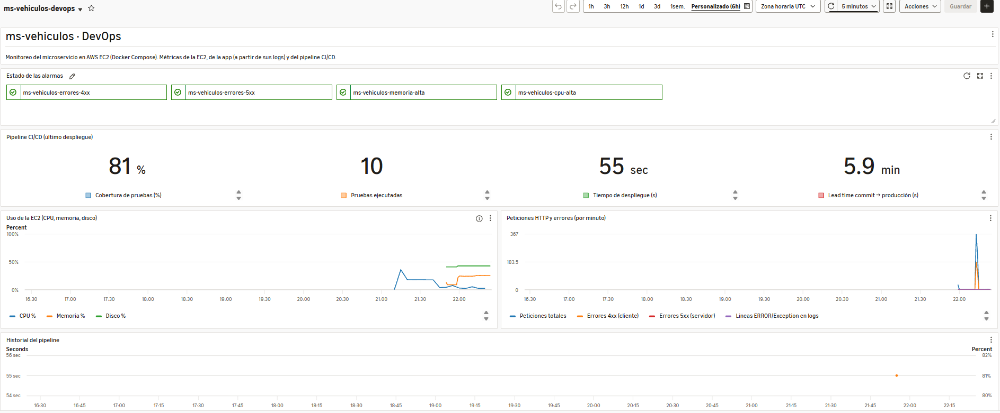

## 8. Cómo ejecutar localmente

```bash
cp .env.example .env        # y poner una clave
docker compose up -d --build
# API:     http://localhost/api/v1/vehiculos
# Swagger: http://localhost/swagger-ui/index.html
```

## 9. Uso de Inteligencia Artificial

Se utilizó **Claude (Anthropic)** como herramienta de apoyo, de acuerdo con las orientaciones de https://bibliotecas.duoc.cl/ia, para:

- Configurar el pipeline de GitHub Actions (etapas, Quality Gate, Hadolint, Trivy).
- Preparar la configuración de Docker Compose para AWS y del monitoreo con CloudWatch (agente, filtros de métricas, alarmas y dashboard).
- Diagnosticar y resolver errores durante el despliegue (conexión SSH, memoria de la EC2, hallazgos de SonarCloud).
- Organizar las evidencias y la estructura de este README.

## 10. Conclusiones y reflexiones individuales

### Justificación técnica de las decisiones

**¿Por qué Docker Compose en AWS EC2?**
Docker Compose nos permite definir, conectar y levantar varios contenedores.

**SonarCloud:**
SonarCloud realiza un análisis estático del código fuente que uno escribe. Detecta errores lógicos y vulnerabilidades de seguridad en el código propio.

**Trivy:**
Trivy es un escáner de seguridad que detecta vulnerabilidades y malas configuraciones en imágenes de contenedores, sistemas de archivos, repositorios Git y manifiestos de Kubernetes.

**¿Por qué el despliegue ocurre solo al hacer merge a `main`?**
El despliegue ocurre solo al hacer merge a `main` porque los Pull Requests (PR) sirven para revisar y validar código sin alterar producción, mientras que `main` suele representar el estado estable o listo para liberar.

**CloudWatch (dashboard y alarmas):**
Configuramos las alarmas de CloudWatch para poder monitorear la infraestructura en tiempo real y así detectar fallos y optimizar el rendimiento 


Lo que más nos costó fue hacer que GitHub Actions realizara correctamente los Pull Requests a causa de un error mínimo en los secretos, entre otras cosas.
### Reflexión de _Nombre 2_

